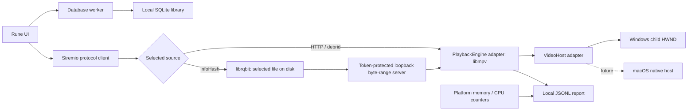

# Skry

A native, Windows-first streaming app. Rune draws the interface. libmpv plays video inside the app. Rust services handle Stremio add-ons and torrents. There is no browser, webview, Electron process, or external player.

**Early prototype, not a full Stremio replacement.** Local SQLite stores watchlists, playlists, watched state, and episode progress. macOS embedding, calendar management, DRM, and universal add-on compatibility are not implemented.

## Run on Windows

Requirements: x64 Windows, Rust 1.97.1 (pinned in `rust-toolchain.toml`), Visual Studio C++ Build Tools, and 7-Zip for runtime setup.

```powershell
pwsh -File scripts/setup-runtime.ps1
cargo run --release
```

The setup script downloads a pinned x64 libmpv build and verifies its SHA-256 checksum. It changes only `runtime/`. You can instead set `SCRY_MPV_LIBRARY` to a trusted libmpv library. For a packaged build, put `libmpv-2.dll` beside `scry.exe`.

Add a catalog provider such as Cinemeta, then add your Torrentio manifest URL in the add-ons screen. A configured manifest can include private credentials in its path. Do not share it or commit local settings.

### Add-on support

Supported: HTTPS manifests, catalog browsing/search, movie and series metadata,
episode IDs, direct HTTP/debrid streams, and BitTorrent v1 `infoHash` sources
with optional file indices and tracker hints. Required catalog filters other
than search are not implemented.

Not yet supported: subtitle add-on resources, streams requiring proxy headers,
YouTube/external-player sources, DRM, add-on configuration web pages, or
Stremio account sync. Unsupported streams show an error rather than silently
dropping required credentials or headers. Add-ons are remote JSON services,
not downloaded plugins executed inside Scry.

Only stream media you have permission to access. Direct torrents expose your IP address to peers, can upload pieces, and use disk space. The torrent engine starts only when a torrent source is selected. Stop removes files downloaded into that engine's own cache directory; crashes or file locks can leave cache files behind. It never sweeps existing directories or deletes library metadata.

## Player controls

Click or drag the timeline to seek. Use the speaker button to mute and the
volume slider to set the level. The CC and audio buttons cycle embedded tracks.

| Key | Action |
| --- | --- |
| Space / K | Play or pause |
| ← / → | Seek back or forward 5 seconds |
| J / L | Seek back or forward 10 seconds |
| ↑ / ↓ | Change volume by 5% |
| M | Mute or unmute |
| C | Cycle subtitles |

Player shortcuts apply only during playback and do not intercept text input.

## Your local library

- Open a title and choose **Want to watch**, **Mark watched**, or a playlist.
- In **Library**, create and rename playlists, reorder titles, and manage your lists.
- Episode progress saves every 12 seconds and on Stop/close. Playback at 90% or a clean end marks the item watched.
- **Mark unwatched** clears progress and sets a manual override. Choose **Auto track** to let playback update its status again.
- **Series actions** manages the whole show separately from individual episodes.

The database is `library.sqlite3` in the OS-local Scry application-data folder
(`%LOCALAPPDATA%\Scry\Scry\data` on Windows). It contains viewing metadata, not
video files or stream credentials. It is local and unencrypted. Close the app
before copying it for backup. There is no cloud account or sync.

Episode browsing uses 100-item pages. Library lists use 200-item pages. The
playlist selector currently shows the first 200 playlists; whole-playlist
reordering is available for playlists under 200 items. Resume playback and
calendar views are not implemented yet.

## Performance diagnostics

Measure the idle native window on Windows (release build, no playback):

```powershell
cargo build --release
pwsh -File scripts/measure-idle.ps1 -Report idle.json
```

Keep the same window size, catalog, and machine for comparisons. The script
waits 15 seconds, then samples for 15 seconds and closes only the app it started.
Use `-ProcessId` to measure an existing window without closing it. Resident memory
includes shared driver/code pages; private bytes measure committed memory, not
resident RAM. The final private working set is closest to Task Manager's default
Memory column. Idle CPU is reported relative to one core.

Posters use a 32-thumbnail RAM cache (up to 4.7 MiB of pixel data) and a disposable local disk cache capped at
32 MiB or 256 files. Disk entries expire seven days after download. Revisits load
small, already-decoded thumbnails instead of downloading and decoding the full
poster again. Cache work stays off the UI thread. Cache failures fall back to the
network. On Windows, the cache is `%LOCALAPPDATA%\Scry\Scry\cache\artwork`;
close Scry before clearing it. It contains image pixels and opaque hashed keys,
not plaintext URLs or credentials, but artwork can still reveal browsing history.
Only nearby catalog rows build full cards; distant rows keep cheap placeholders
for scroll position and back/forward navigation.

To exercise other screens, with Cinemeta already installed and Windows display
scaling at 100%:

```powershell
pwsh -File scripts/measure-ui.ps1 -Report navigation.json
```

This runs a fixed native click/scroll route through movies, title details,
Library, Add-ons, series, and search. It samples memory every 100 ms and reports
CPU work per step. It does not measure click-to-paint latency: each step includes
a fixed settling window and may include network work. The window must have a
1280×820 client area. The script takes foreground focus and closes its own app.
It does not start playback or change watchlists, playlists, or installed add-ons.
Optional `-CaptureDirectory` saves app-only screenshots for checking that each
step reached the intended screen. Screenshots can reveal titles and configuration;
keep them private. Numeric reports contain no URLs, search text, or title names.
See [measured results and remaining limits](docs/ui-performance.md).

```powershell
cargo run --release -- --self-test --report self-test.jsonl
cargo run --release -- --probe "https://your-server.example/authorized-video.mp4" --seconds 30 --report probe.jsonl
cargo run --release -- --analyze probe.jsonl
```

The no-window probe measures fetching and software decoding. It does **not** measure the embedded renderer, hardware decoder, display smoothness, or audio output. Normal embedded playback writes a separate performance report, with the real renderer and hardware-decoder state.

Reports contain numeric playback metrics and decoder identifiers, not media URLs, add-on tokens, titles, or filenames. There is no remote analytics endpoint. Report files can still reveal session timing and machine performance. No fixed RAM claim is made: measure release builds on the same media, resolution, and machine.

## Architecture



- `crates/scry-addons/`: manifest, catalog, metadata, episode IDs, and stream resources.
- `crates/scry-torrents/`: lazy torrent session, file selection, seekable local HTTP delivery. No torrent control API is exposed.
- `crates/scry-playback/`: `PlaybackEngine` contract, dynamic libmpv client binding, playback telemetry, and OS process counters. No Rune dependency.
- `crates/scry-app/src/platform/`: `VideoHost` contract and OS implementations. Win32 stays in `windows.rs`; other systems return a clear unsupported error for embedding.
- `crates/scry-app/src/diagnostics.rs`: no-window playback probes and report analysis.
- `crates/scry-library/`: SQLite repository for watchlists, ordered playlists, watched state, and per-episode progress. See [library semantics](docs/library.md).

The root manifest contains only workspace configuration. `crates/scry-app/`
owns the `scry` binary, Rune UI, workers, search, artwork, and native window host.
It is the default workspace member, so `cargo run` and `cargo build --release`
still select the app and produce `target/release/scry.exe` on Windows. The native
probe example lives in this package too. `runtime/` stays at the workspace root.

The workspace shares dependency versions, one lockfile, and one target directory.
The app depends on all four service crates; torrents depends on add-ons. None of
the service crates depends on the app or Rune.

See [UI state and shortcut ownership](docs/ui-state.md) for feature APIs,
binding registration, and the remaining state extraction work.

### macOS implementation path

Implement `VideoHost` in `crates/scry-app/src/platform/macos.rs`, then select it with `cfg(target_os = "macos")`. Choose an appropriate NSView/libmpv render integration; do not assume a Windows window identifier works on macOS. Add native process counters in `crates/scry-playback/src/process/` and test resizing, Retina scaling, playback lifecycle, audio, and shutdown. Shared add-on and torrent services do not need OS-specific forks.

## Development

```powershell
cargo test --workspace --all-targets
cargo clippy --workspace --all-targets -- -D warnings
# Test standalone crates without building the app:
cargo test -p scry-library
cargo test -p scry-addons
cargo test -p scry-playback
cargo test -p scry-torrents
# Optional live metadata-only protocol smoke test; no stream requests:
cargo run -p scry-addons --example addon_probe
```

Rune is pinned to a Git revision because its API is still developing. `Cargo.lock` should be retained for reproducible app builds. The first build is much larger than the running app: it compiles Rune/wgpu and the torrent dependencies.

libmpv and its codec build have their own license obligations. Include their license notices and satisfy the selected build's source-distribution requirements before redistributing an installer. This repository does not treat third-party binaries as MIT-licensed.

For repeatable hardware-decoded embedded playback checks, see
[the native probe](docs/native-probe.md). The default self-test does not need
FFmpeg; the native probe uses a local synthetic fixture you can generate with FFmpeg.
