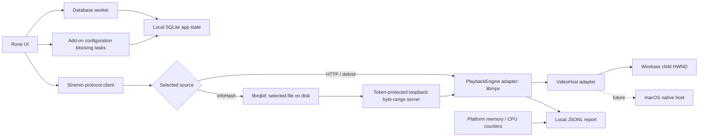

# Scry

A native, Windows-first streaming app. Rune draws the interface. libmpv plays video inside the app. Rust services handle Stremio add-ons and torrents. There is no browser, webview, Electron process, or external player.

**Early prototype, not a full Stremio replacement.** Local SQLite stores saved titles, watched state, and episode progress. macOS embedding, DRM, and universal add-on compatibility are not implemented.

## Run on Windows

Requirements: x64 Windows, Rust 1.97.1 (pinned in `rust-toolchain.toml`), Visual Studio C++ Build Tools, and 7-Zip for runtime setup.

```powershell
pwsh -File scripts/setup-runtime.ps1
cargo run --release
```

The setup script downloads a pinned x64 libmpv build and verifies its SHA-256 checksum. It changes only `runtime/`. You can instead set `Scry_MPV_LIBRARY` to a trusted libmpv library. For a packaged build, put `libmpv-2.dll` beside `scry.exe`.

In **Add-ons**, browse available and installed providers in one list. Choose Cinemeta or Torrentio to open the install dialog, or use **Add by URL** for another provider or your configured Torrentio manifest. A circular spinner shows an install in progress, followed by a success checkmark or an error you can retry. Disable installed providers without losing their configuration, enable them again, or remove them. A configured manifest can include private credentials in its path. Do not share it or commit local settings.

### Add-on support

Supported: HTTP and HTTPS manifests, catalog browsing/search, movie and series metadata,
episode IDs, direct HTTP/debrid streams, and BitTorrent v1 `infoHash` sources
with optional file indices and tracker hints. Movie and TV catalogs load more
automatically near the bottom when the provider supports `skip`. Required catalog
filters other than search and skip are not implemented.

Not yet supported: subtitle add-on resources, streams requiring proxy headers,
YouTube/external-player sources, DRM, add-on configuration web pages, or
Stremio account sync. Unsupported streams show an error rather than silently
dropping required credentials or headers. Add-ons are remote JSON services,
not downloaded plugins executed inside Scry.

Only stream media you have permission to access. Direct torrents expose your IP address to peers, can upload pieces, and use disk space. The torrent engine starts only when a torrent source is selected. Stop removes files downloaded into that engine's own cache directory; crashes or file locks can leave cache files behind. It never sweeps existing directories or deletes library metadata.

## Player controls

Click or drag the timeline to seek. Use the speaker button to mute and the
volume slider to set the level. The CC and audio buttons cycle embedded tracks.

| Key | Action |
| --- | --- |
| Space / K | Play or pause |
| ← / → | Seek back or forward 5 seconds |
| J / L | Seek back or forward 10 seconds |
| ↑ / ↓ | Change volume by 5% |
| M | Mute or unmute |
| C | Cycle subtitles |
| F | Toggle full screen |
| Esc | Exit full screen |

Player shortcuts apply only during playback and do not intercept text input.

**App fullscreen:** press **F11** or use the top-right fullscreen button on any
page. This hides the top bar and the native window frame. Press F11 or Escape,
or use the exit button, to leave. Player fullscreen remains separate.

Catalog titles open a side preview with trailer, library, and watched actions.
Choose **Show** to open the backdrop-based picker. Movies show sources on the
right; TV shows show searchable season/episode lists. Choose an episode for its
sources, then **Back to episodes** to return. Trailers open in your browser;
the trailer button is disabled when the provider supplies no trailer.

## Your local library

- The app starts on **Currently watching**. Open a title to select a source and resume its saved position.
- **What to watch next**, below Currently watching, lists unwatched movies and one next released, unwatched episode per saved show. Open the card to use the full season/episode picker. Cards show that video's resume progress. Show posters instead show aggregate progress and watched/total known episode counts. The list uses 200-title pages and retains release metadata for offline use; future and undated episodes are omitted from this list.
- **Play next movie** and **Play next TV show** in the next-list header open the first matching item on the current page. A single supported source starts automatically; multiple sources stay in the source picker. The buttons are disabled when there is no matching item.
- Open a title and choose **Add to library** to track it, or **Mark watched** to set its status. Right-click titles for quick actions; right-click the page to refresh provider data.
- **Library** has **To watch** and **Watched** lists, with Movies selected by default and a TV series filter. There are no playlist controls.
- Progress saves every 12 seconds and on Stop/close. More than 70% of the duration accumulated as playback marks the item watched; seeking does not count.
- Stopping beyond 90% removes a finished movie from Currently watching or advances to the next known released episode. An unknown/future release is not offered as the next episode.
- **Mark unwatched** clears progress and watched time. Playback tracking resumes automatically; there is no Auto track button.
- **Series actions** manages the whole show separately from individual episodes.
- Right-click the season selector or a season in its list to mark all of that season's episodes watched or unwatched, including episodes beyond the visible page.
- Season and source-provider dropdowns overlay the page without shifting content. Escape or an outside click closes them.
- A show's watched badge means every episode in its known inventory is released and watched. Future and undated episodes count toward overall progress, so watching four of eight known episodes means 50%, not complete. **Mark show watched** marks only its released episodes; **Mark show unwatched** resets its stored episodes. New inventory can move a saved show back to **To watch**. Totals depend on the episodes supplied by the provider.
- Marking a known future movie or episode watched is a silent no-op. Season/show actions also skip undated episodes in the stored inventory. Movies without a known release date keep their existing behavior.

The database is `scry-v2.sqlite3` in the OS-local Scry application-data folder
(`%LOCALAPPDATA%\Scry\Scry\data` on Windows). It contains installed add-ons,
library metadata, playlists, watched state, and playback progress. Add-on URLs
can contain credentials: the database is local and unencrypted, so do not share it.
Close the app before copying it for backup. Images, temporary media, and diagnostic
reports remain external files. There is no cloud account or sync.

Storage uses Diesel with an embedded schema. Existing `scry-v2.sqlite3` schema-one
databases upgrade automatically, preserving watch history and add-ons. Older database
formats are not imported or deleted. See [library semantics](docs/library.md).

Episode browsing uses 100-item pages. Library lists use 200-item pages.
**Calendar** has Week and Month views; each day has its own scrollable release
list and an expand button for a larger day dialog. Month view shows only that
month's dates. Saved movies and series appear when metadata supplies an exact
release date, not stream availability. The calendar includes the full saved library
without title pages. Refresh retrieves current metadata with bounded concurrency.
Undated releases are omitted. There is no background
new-release notification service yet.

## Performance diagnostics

For unattended full-app streaming, scrolling, and navigation measurements with
an isolated 1,000-title library and original synthetic media:

```powershell
python scripts/profile-app.py --build --report target/perf-run
python scripts/profile-app.py --torrent --report target/perf-torrent
```

This requires Python 3, FFmpeg, and an unlocked Windows desktop. New control and
profiling hooks compile only with the non-default `profiling` feature. A normal
release build excludes them. See [memory profiling](docs/memory-profiling.md).

Measure the idle native window on Windows (release build, no playback):

```powershell
cargo build --release
pwsh -File scripts/measure-idle.ps1 -Report idle.json
```

Keep the same window size, catalog, and machine for comparisons. The script
waits 15 seconds, then samples for 15 seconds and closes only the app it started.
Use `-ProcessId` to measure an existing window without closing it. Resident memory
includes shared driver/code pages; private bytes measure committed memory, not
resident RAM. The final private working set is closest to Task Manager's default
Memory column. Idle CPU is reported relative to one core.

Posters use a 32-thumbnail RAM cache (up to 4.7 MiB of pixel data) and a disposable local disk cache capped at
32 MiB or 256 files. Disk entries expire seven days after download. Revisits load
small, already-decoded thumbnails instead of downloading and decoding the full
poster again. Cache work stays off the UI thread. Cache failures fall back to the
network. On Windows, the cache is `%LOCALAPPDATA%\Scry\Scry\cache\artwork`;
close Scry before clearing it. It contains image pixels and opaque hashed keys,
not plaintext URLs or credentials, but artwork can still reveal browsing history.
Pages with no visible artwork release decoded RAM-cache entries, including during steady playback.
Only nearby rows build cards and layout nodes. Spacer blocks represent offscreen
rows, preserving scroll position and back/forward navigation. Geometry and requests
update per section rather than per row.

To exercise other screens, with Cinemeta already installed and Windows display
scaling at 100%:

```powershell
pwsh -File scripts/measure-ui.ps1 -Report navigation.json
```

This runs a fixed native click/scroll route through movies, title details,
Library, Add-ons, series, and search. It samples memory every 100 ms and reports
CPU work per step. It does not measure click-to-paint latency: each step includes
a fixed settling window and may include network work. The window must have a
1280×820 client area. The script takes foreground focus and closes its own app.
It does not start playback or change watchlists, playlists, or installed add-ons.
Optional `-CaptureDirectory` saves app-only screenshots for checking that each
step reached the intended screen. Screenshots can reveal titles and configuration;
keep them private. Numeric reports contain no URLs, search text, or title names.
See [measured results and remaining limits](docs/ui-performance.md).

```powershell
cargo run --release -- --self-test --report self-test.jsonl
cargo run --release -- --probe "https://your-server.example/authorized-video.mp4" --seconds 30 --report probe.jsonl
cargo run --release -- --analyze probe.jsonl
```

The no-window probe measures fetching and software decoding. It does **not** measure the embedded renderer, hardware decoder, display smoothness, or audio output. Normal embedded playback writes a separate performance report, with the real renderer and hardware-decoder state.

Reports contain numeric playback metrics and decoder identifiers, not media URLs, add-on tokens, titles, or filenames. There is no remote analytics endpoint. Report files can still reveal session timing and machine performance. No fixed RAM claim is made: measure release builds on the same media, resolution, and machine.

## Architecture



- `crates/scry-addons/`: manifest, catalog, metadata, episode IDs, and stream resources.
- `crates/scry-torrents/`: lazy torrent session, file selection, seekable local HTTP delivery. No torrent control API is exposed.
- `crates/scry-playback/`: `PlaybackEngine` contract, dynamic libmpv client binding, playback telemetry, and OS process counters. No Rune dependency.
- `crates/scry-app/src/platform/`: `VideoHost` contract and OS implementations. Win32 stays in `windows.rs`; other systems return a clear unsupported error for embedding.
- `crates/scry-app/src/diagnostics.rs`: no-window playback probes and report analysis.
- `crates/scry-library/`: Diesel/SQLite repository and a single embedded schema for installed add-ons, watchlists, ordered playlists, watched state, per-video progress, and derived show summaries. See [library semantics](docs/library.md).

The root manifest contains only workspace configuration. `crates/scry-app/`
owns the `scry` binary, Rune UI, workers, search, artwork, and native window host.
It is the default workspace member, so `cargo run` and `cargo build --release`
still select the app and produce `target/release/scry.exe` on Windows. The native
probe example lives in this package too. `runtime/` stays at the workspace root.

The workspace shares dependency versions, one lockfile, and one target directory.
The app depends on all four service crates; torrents depends on add-ons. None of
the service crates depends on the app or Rune.

See [UI state and shortcut ownership](docs/ui-state.md) for feature APIs,
binding registration, and the remaining state extraction work.
See [the persistence and UI review](docs/architecture-review.md) for the rebuild,
its findings, regression coverage, and remaining limits.
See [the shared UI system](docs/ui-system.md) for colors, icons, primitives,
and the Clippy and test rules that prevent visual drift.

### macOS implementation path

Implement `VideoHost` in `crates/scry-app/src/platform/macos.rs`, then select it with `cfg(target_os = "macos")`. Choose an appropriate NSView/libmpv render integration; do not assume a Windows window identifier works on macOS. Add native process counters in `crates/scry-playback/src/process/` and test resizing, Retina scaling, playback lifecycle, audio, and shutdown. Shared add-on and torrent services do not need OS-specific forks.

## Development

Local checks and their rationale are documented in the
[Rust quality and performance policy](docs/rust-quality.md).

```powershell
pwsh -File scripts/check.ps1
pwsh -File scripts/check.ps1 -AllFeatures
# Optional dependency checks (install once):
cargo install cargo-audit --locked --version 0.22.2
cargo install cargo-machete --locked --version 0.9.1
pwsh -File scripts/check.ps1 -AllFeatures -Dependencies
# Test standalone crates without building the app:
cargo test -p scry-library
cargo test -p scry-addons
cargo test -p scry-playback
cargo test -p scry-torrents
# Optional live metadata-only protocol smoke test; no stream requests:
cargo run -p scry-addons --example addon_probe
```

Rune is pinned to Git revision `e18cc657232a93af500b40917880c02cd4edd069`. Cargo downloads Rune and its dependencies; no framework fork is maintained in this repository. `Cargo.lock` should be retained for reproducible app builds. The first build is much larger than the running app: it compiles Rune/wgpu and the torrent dependencies.

libmpv and its codec build have their own license obligations. Include their license notices and satisfy the selected build's source-distribution requirements before redistributing an installer. This repository does not treat third-party binaries as MIT-licensed.

For repeatable hardware-decoded embedded playback checks, see
[the native probe](docs/native-probe.md). The default self-test does not need
FFmpeg; the native probe uses a local synthetic fixture you can generate with FFmpeg.
