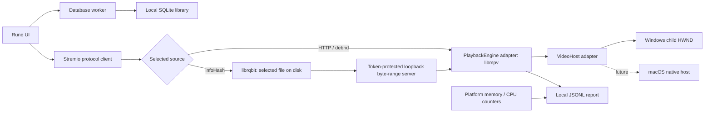

# Scry

A native, Windows-first streaming app. Rune draws the interface. libmpv plays video inside the app. Rust services handle Stremio add-ons and torrents. There is no browser, webview, Electron process, or external player.

**Early prototype, not a full Stremio replacement.** Local SQLite stores watchlists, playlists, watched state, and episode progress. macOS embedding, calendar management, DRM, and universal add-on compatibility are not implemented.

## Run on Windows

Requirements: x64 Windows, Rust 1.97.1 (pinned in `rust-toolchain.toml`), Visual Studio C++ Build Tools, and 7-Zip for runtime setup.

```powershell
pwsh -File scripts/setup-runtime.ps1
cargo run --release
```

The setup script downloads a pinned x64 libmpv build and verifies its SHA-256 checksum. It changes only `runtime/`. You can instead set `SCRY_MPV_LIBRARY` to a trusted libmpv library. For a packaged build, put `libmpv-2.dll` beside `scry.exe`.

Add a catalog provider such as Cinemeta, then add your Torrentio manifest URL in the add-ons screen. A configured manifest can include private credentials in its path. Do not share it or commit local settings.

### Add-on support

Supported: HTTPS manifests, catalog browsing/search, movie and series metadata,
episode IDs, direct HTTP/debrid streams, and BitTorrent v1 `infoHash` sources
with optional file indices and tracker hints. Required catalog filters other
than search are not implemented.

Not yet supported: subtitle add-on resources, streams requiring proxy headers,
YouTube/external-player sources, DRM, add-on configuration web pages, or
Stremio account sync. Unsupported streams show an error rather than silently
dropping required credentials or headers. Add-ons are remote JSON services,
not downloaded plugins executed inside Scry.

Only stream media you have permission to access. Direct torrents expose your IP address to peers, can upload pieces, and use disk space. The torrent engine starts only when a torrent source is selected. Stop removes files downloaded into that engine's own cache directory; crashes or file locks can leave cache files behind. It never sweeps existing directories or deletes library metadata.

## Your local library

- Open a title and choose **Want to watch**, **Mark watched**, or a playlist.
- In **Library**, create and rename playlists, reorder titles, and manage your lists.
- Episode progress saves every 12 seconds and on Stop/close. Playback at 90% or a clean end marks the item watched.
- **Mark unwatched** clears progress and sets a manual override. Choose **Auto track** to let playback update its status again.
- **Series actions** manages the whole show separately from individual episodes.

The database is `library.sqlite3` in the OS-local Scry application-data folder
(`%LOCALAPPDATA%\Scry\Scry\data` on Windows). It contains viewing metadata, not
video files or stream credentials. It is local and unencrypted. Close the app
before copying it for backup. There is no cloud account or sync.

Episode browsing uses 100-item pages. Library lists use 200-item pages. The
playlist selector currently shows the first 200 playlists; whole-playlist
reordering is available for playlists under 200 items. Resume playback and
calendar views are not implemented yet.

## Performance diagnostics

```powershell
cargo run --release -- --self-test --report self-test.jsonl
cargo run --release -- --probe "https://your-server.example/authorized-video.mp4" --seconds 30 --report probe.jsonl
cargo run --release -- --analyze probe.jsonl
```

The no-window probe measures fetching and software decoding. It does **not** measure the embedded renderer, hardware decoder, display smoothness, or audio output. Normal embedded playback writes a separate performance report, with the real renderer and hardware-decoder state.

Reports contain numeric playback metrics and decoder identifiers, not media URLs, add-on tokens, titles, or filenames. There is no remote analytics endpoint. Report files can still reveal session timing and machine performance. No fixed RAM claim is made: measure release builds on the same media, resolution, and machine.

## Architecture



- `src/addons.rs`: manifest, catalog, metadata, episode IDs, and stream resources.
- `src/torrents.rs`: lazy torrent session, file selection, seekable local HTTP delivery. No torrent control API is exposed.
- `src/playback.rs`: `PlaybackEngine` contract and dynamic libmpv client binding.
- `src/platform/`: `VideoHost` contract and OS implementations. Win32 stays in `windows.rs`; other systems return a clear unsupported error for embedding.
- `src/telemetry.rs`: samples, stall detection, summaries, and report output.
- `src/diagnostics.rs`: no-window playback probes and report analysis.
- `src/library.rs`: SQLite repository for watchlists, ordered playlists, watched state, and per-episode progress. See [library semantics](docs/library.md).

### macOS implementation path

Implement `VideoHost` in `src/platform/macos.rs`, then select it with `cfg(target_os = "macos")`. Choose an appropriate NSView/libmpv render integration; do not assume a Windows window identifier works on macOS. Add native process counters and test resizing, Retina scaling, playback lifecycle, audio, and shutdown. Shared add-on and torrent services do not need OS-specific forks.

## Development

```powershell
cargo test
cargo clippy --all-targets -- -D warnings
# Optional live metadata-only protocol smoke test; no stream requests:
cargo run --example addon_probe
```

Rune is pinned to a Git revision because its API is still developing. `Cargo.lock` should be retained for reproducible app builds. The first build is much larger than the running app: it compiles Rune/wgpu and the torrent dependencies.

libmpv and its codec build have their own license obligations. Include their license notices and satisfy the selected build's source-distribution requirements before redistributing an installer. This repository does not treat third-party binaries as MIT-licensed.

For repeatable hardware-decoded embedded playback checks, see
[the native probe](docs/native-probe.md). The default self-test does not need
FFmpeg; the native probe uses a local synthetic fixture you can generate with FFmpeg.
