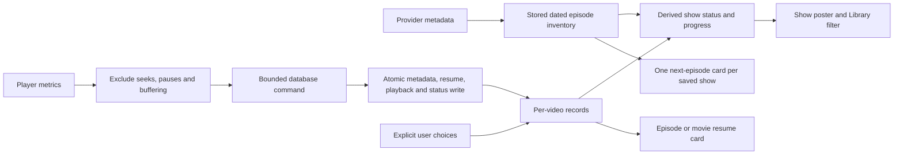

# Persistence, progress, and UI review

This rebuild changes the storage and presentation foundations without replacing
the working add-on protocol, player adapter, or torrent bridge. There is no
deployed-data upgrade path. See [library semantics](library.md) and
[performance checks](ui-performance.md) for the exact rules and test workload.

## Findings and changes

| Finding | Change |
| --- | --- |
| A show poster represented one unfinished episode, not the show | Separate episode resume, actual playback, watched status, and full released-episode summaries |
| Show completion was copied into another mutable watched flag | Derive it from episode records in `effective_watched`; show actions mark/reset episodes rather than installing overrides |
| Provider availability affected whether the show could be summarized | Persist dated inventory and evaluate known release dates locally |
| Standalone progress saves could mark an item watched after a seek | Resume saves never establish watched status; actual playback drives automatic status |
| Advancing reset an existing next episode's position | Preserve it; do not activate an already-watched next episode |
| Metadata registration and playback could partly commit | Atomic metadata batches and atomic metadata-plus-sample writes |
| A playback save updated every sibling, including inactive episodes | Update only active siblings; index recency and active viewing |
| Release changes rewrote a show's entire inventory | Compare snapshots and write changed/new/withdrawn release rows only |
| List progress and visible state used per-item lookup loops | Join progress into page queries and batch visible identity reads |
| An experimental LEFT JOIN of derived state materialized the full library | Use keyed scalar reads of that view; inspect actual query plans |
| Next-up expanded a show into hundreds of repeated posters | One next released, unwatched episode per saved show, with title-level pagination |
| Offscreen rows still had layout nodes and per-row request callbacks | Contiguous spacer windowing and coherent per-section geometry updates |
| Refresh briefly removed all known poster statuses | Keep the last keyed presentation state until its replacement arrives |
| Library paging also changed the currently-watching offset | Give Library, watching, next-up, and calendar independent offsets |
| Read errors could consume pending write acknowledgements | Distinguish request failures from mutation failures |
| Show artwork and show progress could fetch the same full metadata separately | Reuse series metadata for saved artwork; use a separate artwork lookup only as fallback |
| Dropdown lists took space inside their page panels | Root-level anchored overlays with focus return and outside/Escape dismissal |
| Startup carried a migration framework that this build does not need | One embedded schema, empty-store initialization, schema validation, and no migration dependency |
| Concurrent worker startup could race the initial WAL-mode switch | Serialize initialization with a process-local gate; normal reads/writes remain independent |
| Future titles could be explicitly marked watched | Persist/capture release dates; silently skip future items in individual, season, show, and playback paths |
| Cached badges could survive a known release while the app stayed open | Schedule a wake at the next stored release time and refresh derived state |
| Catalog browsing stopped after its first response | Append provider pages near the scroll end; deduplicate, preserve position/history, and stop empty/repeated pages |

## State flow

## Retained foundations

- The database worker, network event queue, artwork queue, decoder buffers, and
  in-memory/disk thumbnail caches already have explicit bounds. Keep them bounded.
- WAL, foreign-key checks, bound SQL parameters, and immediate write transactions
  remain appropriate for this local application. A database server or UI-thread
  connection would add complexity, not solve the observed problems.
- Add-on tasks are cancellable, responses are size/time limited, and stale UI
  results use generation guards. Provider identity and unsupported source checks
  remain in place.
- libmpv and torrents start lazily. The player retains bounded demuxer caches.
  Torrent delivery remains a token-protected loopback byte-range server, not a
  public torrent-control API. No replacement was justified by this review.
- Standalone playlist storage is currently unused by the UI. It remains in the
  repository; this rebuild does not remove that unrelated API.

## Validation and limits

Regression coverage includes persistence/reopen, concurrent initialization,
rollback, explicit watched/reset actions, seeks, actual versus resume progress, released and
future episodes, inventories beyond one page, grouped next-up pagination,
rapid scroll/return, cached poster restoration, history, episode selection,
dropdown geometry, keyboard actions, and existing player/source controls.

Headless Rune tests exercise real layout and input routing, not GPU-driver
behavior. The affected machine still needs a native populated-library stress
run before claiming the reported freeze is conclusively gone. No total-memory
reduction or atlas-compaction claim is made. The renderer dependency is unchanged.

Progress intentionally measures accumulated playback, not unique watched time
ranges. Replayed portions count. Show progress is episode-weighted because most
providers do not supply the duration of every episode. These are explicit
semantics, not separate guessed show-duration counters.

Saved poster URL/year metadata remains an in-memory provider cache. Decoded
thumbnails are cached on disk, but a cold offline session can still show title
placeholders until it knows the poster URL. Persisting a bounded metadata cache
is a possible follow-up; it is not required to calculate watch state correctly.
